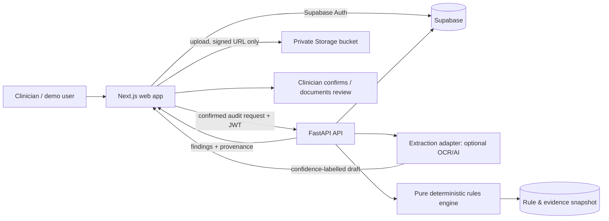

# AMR Sentinel AI — Architecture

## 1. Design principles

- **Deterministic core, assistive edge:** OCR/AI may extract and retrieve; it never decides a clinical outcome.
- **Human confirmation:** audit only confirmed structured facts. Unknowns remain unknown.
- **Evidence-bound:** every rule execution references versioned evidence and rule data.
- **Privacy by default:** synthetic demo data; minimum necessary storage; server-only secrets.
- **Local-first:** cloud deployment is optional, not a prerequisite for a credible demo.

## 2. Stack

| Layer | Choice | Notes |
|---|---|---|
| Web | Next.js App Router, React, TypeScript, Tailwind CSS | Vercel target; accessible responsive UI |
| API | Python 3.12+, FastAPI, Pydantic v2 | OpenAPI generated from schemas |
| Rules | Pure Python module | No network, ORM, LLM, or provider imports |
| Data | Supabase Postgres/Auth/Storage/RLS | Use MCP for migrations and administration where available |
| Tests | Pytest, Vitest/React Testing Library, Playwright | Include rules regression fixtures |
| Optional intake | Tesseract/PaddleOCR locally; provider-backed extraction only behind adapter | Return confidence; never required |
| Deployment | Vercel web + Railway API | Validate current free-tier limitations before launch |

## 3. System flow



### Audit sequence

1. UI validates basic fields and obtains the user JWT.
2. Optional extraction produces a draft only. User edits and confirms it.
3. API validates the request with Pydantic, authorizes the user, loads the active immutable rule/evidence snapshot, and calls `engine.audit()`.
4. Engine returns structured findings; API stores a case/audit snapshot transactionally and returns the report.
5. UI renders findings without translating them into a prescription. Acknowledgements and permitted overrides are separately logged.

## 4. Backend modules

| Module | Responsibility |
|---|---|
| `api` | Auth, request validation, routes, response mapping |
| `schemas` | Pydantic request/response and domain models |
| `engine` | Pure rule evaluation, scoring/status mapping, no I/O |
| `rules_data` | Versioned rule manifests and evidence references |
| `services` | Case persistence, audit orchestration, storage, metrics |
| `extraction` | OCR/provider adapters and local fallback |
| `repositories` | Supabase/Postgres access; never imported by engine |
| `security` | JWT verification, authorization, redaction, audit logging |

## 5. Suggested repository layout

```text
amr-sentinel-ai/
  apps/web/
    app/(app)/dashboard/  app/(app)/cases/  app/(public)/
    components/  lib/  tests/
  services/api/
    app/api/v1/  app/schemas/  app/engine/  app/rules_data/
    app/services/  app/repositories/  app/extraction/  tests/
  packages/contracts/       # OpenAPI-generated TS client or shared JSON schemas
  supabase/migrations/  supabase/seed.sql  supabase/functions/
  docs/  scripts/  .env.example
```

## 6. API surface (MVP)

| Route | Purpose |
|---|---|
| `GET /health` | liveness, build version, active rule-set version (no PHI) |
| `POST /v1/extractions` | start/return editable extraction draft; authenticated |
| `POST /v1/audits` | run deterministic audit on confirmed structured payload |
| `GET /v1/cases/{id}` | authorized case/audit history |
| `POST /v1/audits/{id}/acknowledgements` | record review acknowledgement / permitted override reason |
| `GET /v1/evidence/{id}` | evidence metadata and source link/version |
| `GET /v1/metrics` | de-identified aggregate metrics for authorized admin |

Use `/docs` only in development or behind authenticated access in a demo deployment. Apply request size/type limits to uploads, rate limits to public-facing routes, and opaque error IDs in responses.

## 7. Deployment topology

- **Vercel:** Next.js UI; only public configuration may use `NEXT_PUBLIC_*` variables.
- **Railway:** FastAPI container/service; environment secrets held in Railway, not browser code.
- **Supabase:** Auth, Postgres, private Storage. The API uses a constrained server credential; browser uses only anon key plus RLS.
- **Local:** `web:3000`, `api:8000`, Supabase local stack or a local database adapter. CI runs lint, unit tests, migration checks, and rules isolation tests.

Do not place the Supabase service-role key, OCR keys, database URL, or clinical source files in client bundles, git history, or screenshots.

## 8. Failure behavior

| Failure | Safe behavior |
|---|---|
| OCR/AI unavailable | Offer manual input; mark extraction unavailable; audit still works |
| Missing data | Return `needs_confirmation`, state which values are missing |
| Evidence snapshot unavailable | Do not audit; show an operational error and trace ID |
| Database unavailable | Do not claim persistence; allow no silent local fallback for PHI |
| Unknown drug/indication | Do not infer; flag for clinician confirmation |

## 9. Architecture tests

Add AST/import tests that fail if `engine/` imports HTTP clients, database clients, SDKs, environment access, or AI modules. Add contract tests for API schemas, migration/RLS tests, and golden audit fixtures pinned to evidence versions.
